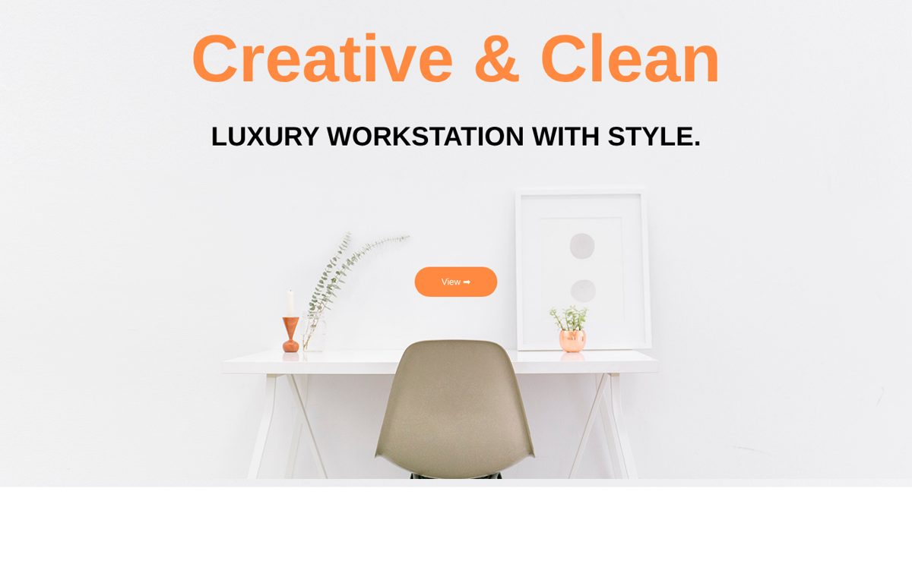

# Creative & Clean

Landing page de mobiliario para espacios de trabajo, con secciones alternadas de imagen y texto. Construida desde cero con HTML y CSS a partir de un diseño, como práctica de maquetación web.

 

**[Ver demo en vivo](https://rich4rdx.github.io/proyecto-creative-clean/)**



## Qué practiqué

- Maquetación semántica con HTML5 (`header`, `nav`, `section`, `footer`)
- Distribución de secciones con Flexbox
- Diseño adaptable a pantallas pequeñas con media queries

## Cómo verlo en tu computador

```bash
git clone https://github.com/Rich4rdx/proyecto-creative-clean.git
```

Abre `index.html` en el navegador. No necesita instalar nada.

## Autor

**Richard**: [github.com/Rich4rdx](https://github.com/Rich4rdx)
